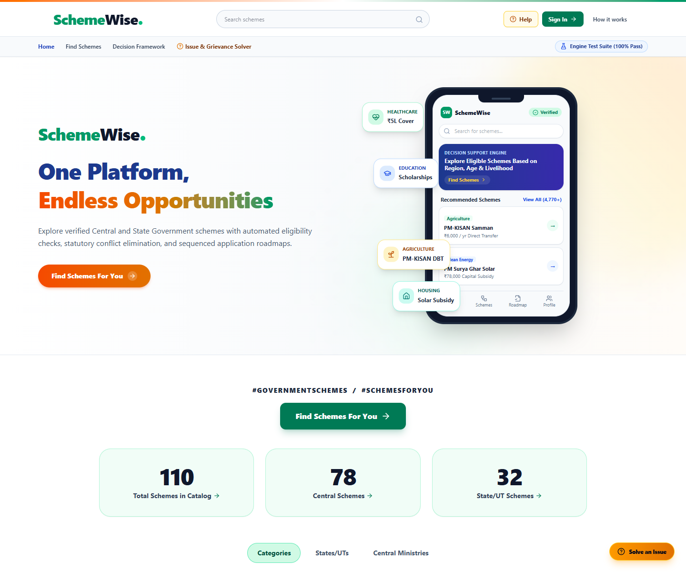
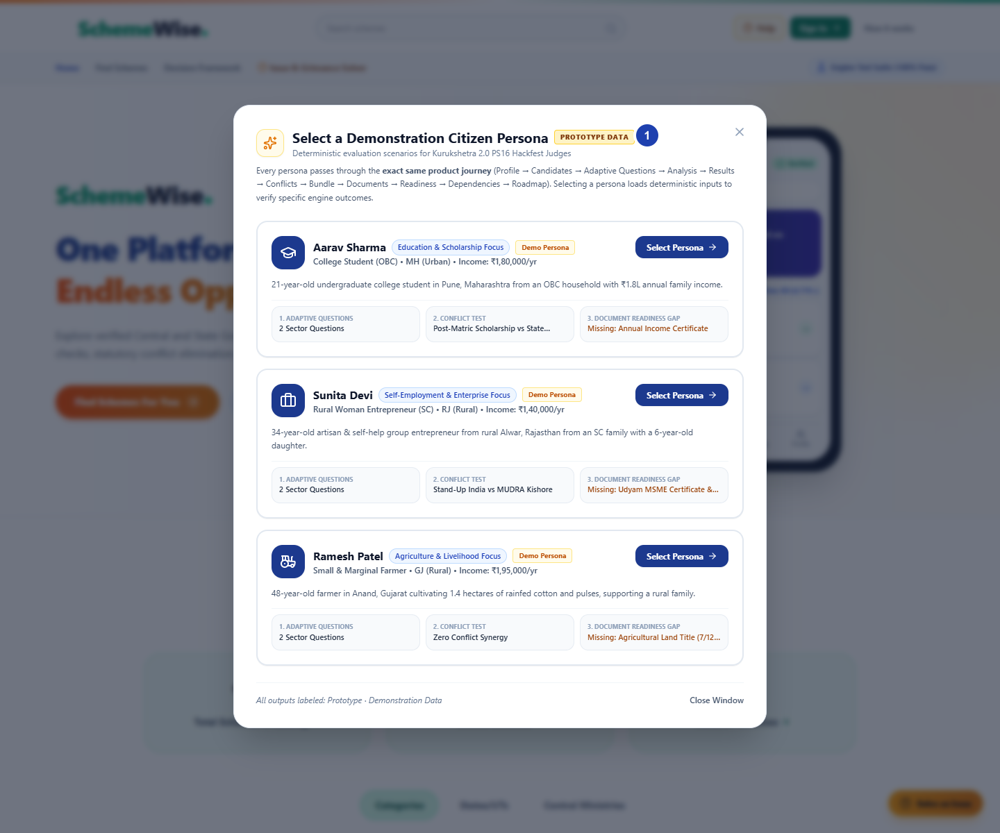
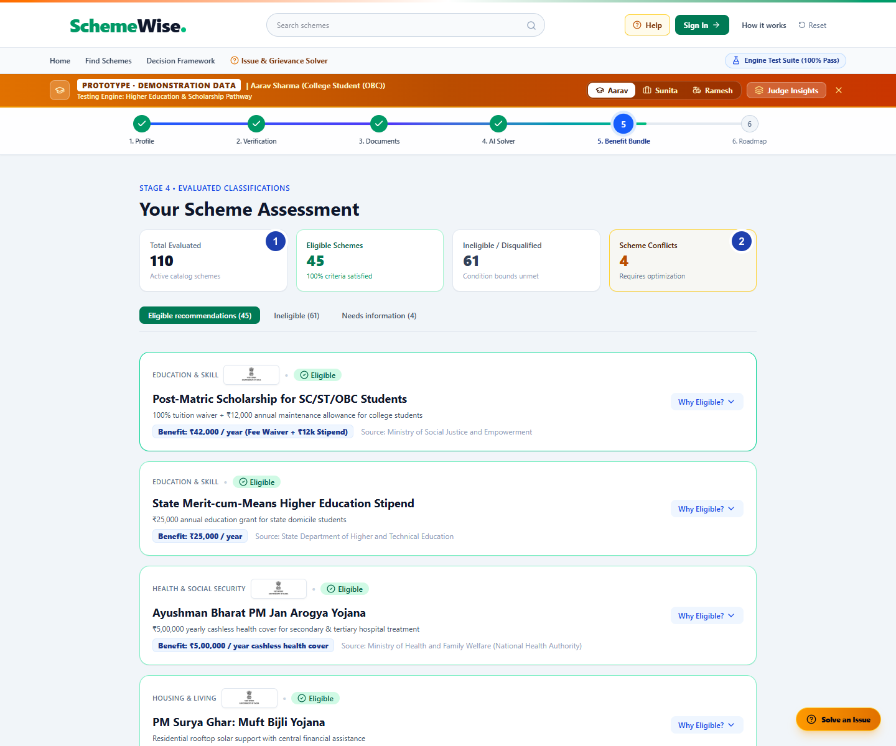
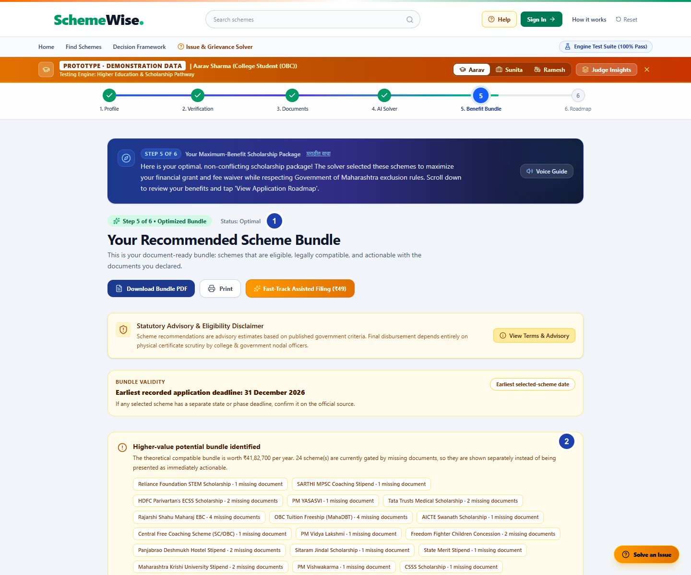
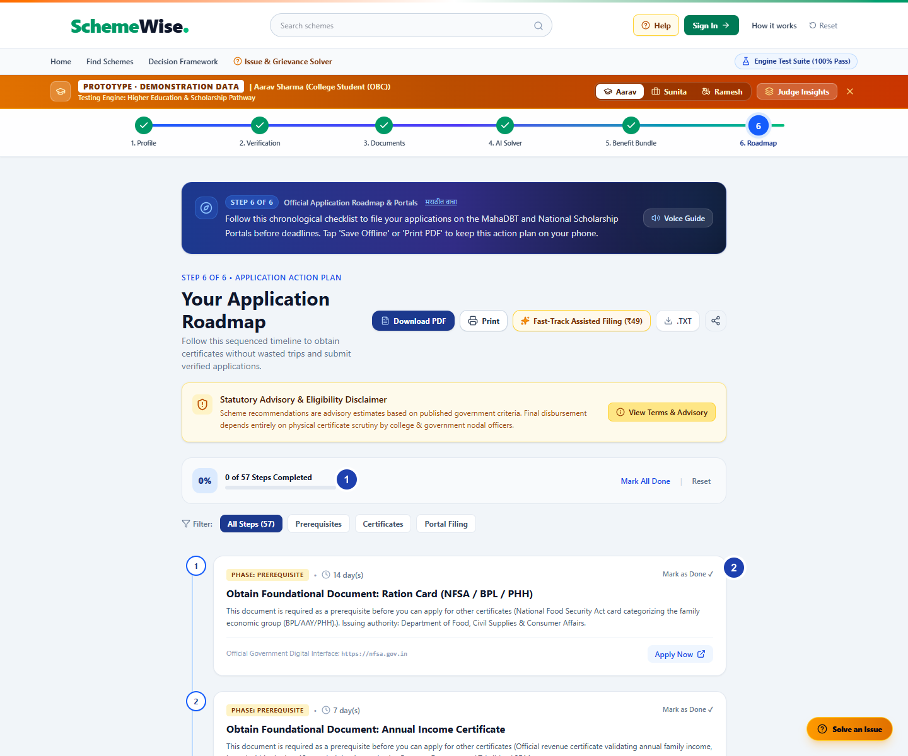

# SchemeWise — Autonomous Scheme-Bundle Optimizer

> Kurukshetra 2.0 Hackfest 2026 · Problem Statement PS16

[](LICENSE)
[](https://react.dev)
[](https://www.typescriptlang.org/)
[](https://vitejs.dev/)
[](https://tailwindcss.com/)

---

## Live demo

**[Open SchemeWise](https://schemewise-nu.vercel.app/)** — existing Vercel deployment, checked October 14, 2026. This deployment is an older build and may not match the screenshots or current repository.

SchemeWise is a citizen-facing prototype for exploring government scheme discovery, profile-based matching, eligibility checks, conflict-aware bundles, document readiness, and an application roadmap. It uses a curated sample catalog and demonstration personas. In the current repository, the in-app catalog contains 110 scheme records (78 Central and 32 State/UT); the landing page's `4,770+` discovery figure is not a count of records evaluated by this prototype. Demo results are illustrative, not official eligibility decisions. Verify current rules, amounts, and deadlines with the linked government portals.

## Screenshots

Desktop captures of the live app at 1440 × 1200. Demonstration-profile screens are labeled in the app as prototype data. Numbered markers point to details described in each caption; open **original capture** for the unmarked image.

<p align="center">
  
  <br /><em>Home — the public landing page and entry point to the assessment.</em>
  · <a href="docs/screenshots/01-home-original.png">Original capture</a>
</p>

<p align="center">
  
  <br /><em>Demo personas — marker 1 highlights the prototype-data label; each card previews its scenario.</em>
  · <a href="docs/screenshots/02-demo-personas-original.png">Original capture</a>
</p>

<p align="center">
  
  <br /><em>Eligibility results — markers 1 and 2 highlight the result counts and modeled conflicts for the selected demo profile.</em>
  · <a href="docs/screenshots/03-eligibility-results-original.png">Original capture</a>
</p>

<p align="center">
  
  <br /><em>Optimized bundle — marker 1 identifies the optimization status; marker 2 points to additional potential benefits gated by missing documents. Values shown come from a demonstration profile.</em>
  · <a href="docs/screenshots/04-optimized-bundle-original.png">Original capture</a>
</p>

<p align="center">
  
  <br /><em>Application roadmap — marker 1 shows progress tracking; marker 2 points to the first prerequisite task in the sequence.</em>
  · <a href="docs/screenshots/05-application-roadmap-original.png">Original capture</a>
</p>

---

## 📌 1. Executive Summary & Problem Context

Citizens navigating welfare schemes in India face three common challenges:
1. **Discovery Fragmentation**: Scheme information is distributed across ministry and state portals.
2. **Overlapping Rules**: Some programs have exclusions or duplicate-benefit restrictions that applicants need to check.
3. **Application Friction**: Applicants may need to identify prerequisite documents and the correct order for obtaining them.

**SchemeWise** is a decision-support prototype inspired by myScheme and Digital India citizen-service patterns. Its guided flow evaluates a profile against a curated sample catalog, surfaces modeled eligibility and conflict rules, builds a compatible bundle, and sequences document prerequisites. Demo flows use fixed prototype profiles and a self-declared document checklist; they do not require uploading documents. Confirm real application requirements and current policy details with the linked official portals.

---

## 🚀 2. Core Capabilities & Innovation

| Feature | Description |
| :--- | :--- |
| **Citizen experience** | React interface for scheme discovery, category browsing, profile intake, and guided assessment. |
| **Deterministic matching** | Rules evaluate demographic, regional, livelihood, and document inputs against the checked-in prototype catalog. |
| **Conflict-aware bundle** | The app identifies modeled mutual-exclusion pairs and presents a compatible, value-ranked bundle. |
| **Document readiness and roadmap** | Self-declared document checklist, prerequisite links, and sequenced application actions. |
| **Demonstration personas** | Three labeled sample profiles exercise student, woman entrepreneur, and farmer scenarios. |
| **Optional explanations** | The Express API can use the Google GenAI SDK when `GEMINI_API_KEY` is configured; deterministic results do not depend on it. |

---

## 📂 3. Repository Structure

```
.
├── server.ts                  # Express dev/API server and optional Gemini explanations
├── package.json               # Frontend/server scripts and dependencies
├── bun.lock                   # Bun dependency lockfile
├── src/
│   ├── App.tsx                # Assessment stages and app state
│   ├── components/            # Citizen, admin, and shared UI
│   ├── data/                  # Curated prototype schemes and demo profiles
│   ├── engine/                # Eligibility, conflict, bundle, and roadmap logic
│   ├── services/              # API and document export helpers
│   └── types/                 # Shared TypeScript models
├── docs/                      # Architecture, project notes, and screenshots
└── data/                      # Data schema notes and sample records
```

---

## 🛠️ 4. Technology Stack

- **Frontend Core**: React 19, TypeScript 5.8
- **Build & Dev Tooling**: Vite 6.2, Node.js
- **Styling & Design System**: Tailwind CSS v4, Lucide React icons
- **Animation**: Motion 12
- **API**: Express 4; Google GenAI SDK for optional explanations when a server key is configured
- **Assessment persistence**: Local browser storage for an in-progress draft

The Vercel link above serves the frontend. The repository also includes an Express server for local/API use; the current Vercel configuration does not deploy that server as API functions. Without the optional Gemini key, the app uses its deterministic explanations.

---

## ⚡ 5. Quick Start & Local Setup

### Prerequisites
- Node.js `v18.0.0` or higher
- Bun (the repository includes `bun.lock`)

### Installation
```bash
# 1. Clone the repository
git clone https://github.com/Gaura3z/autonomous-scheme-bundle-optimizer.git
cd autonomous-scheme-bundle-optimizer

# 2. Install the locked dependencies
bun install --frozen-lockfile

# 3. Start the development server (Binds to 0.0.0.0:3000)
bun run dev

# 4. Open in browser
http://localhost:3000
```

### Production Build
```bash
bun run build
bun run preview
```

---

## 🧪 6. Testing with Demo Personas (For Judges)

The landing page's phone preview includes a **Profile** entry point to the demonstration persona selector. Select **Aarav Sharma**, **Sunita Devi**, or **Ramesh Patel** to load a labeled prototype profile and follow its assessment. These fixed sample scenarios are for demonstrating the interface and engine paths; outputs are not individualized government determinations.

---

## 👥 7. Team Details

| Role | Name | Email |
| :--- | :--- | :--- |
| **Team Lead / Full Stack** | Savita Biradar | savitabiradar109@gmail.com |
| **Problem Statement** | PS16: Autonomous Decision-Support Optimizer | Kurukshetra 2.0 Hackfest |

---
*Built with ❤️ for Digital Public Infrastructure (DPI) & Citizen Empowerment.*
